# AI for Network Security — Learner Guide

**WSQ Course Code:** TGS-2024051414  |  **Conducted by:** Tertiary Infotech Academy Pte Ltd (UEN 201200696W)  |  **Version v1.2 · 29 August 2026**

## Contents

- [Introduction](#introduction)
- [Course Learning Outcomes](#course-learning-outcomes)
- [Underpinning Knowledge and Abilities Assessed](#underpinning-knowledge-and-abilities-assessed)
- [Before You Start — Environment Setup](#before-you-start--environment-setup)
- [How the Labs Build on Each Other](#how-the-labs-build-on-each-other)
- [Topic 01 — AI-Assisted Network Threat and Vulnerability Analysis  (25%)](#topic-01--ai-assisted-network-threat-and-vulnerability-analysis--25)
  - [Lab 1 — Map the ICT Network and Analyse Its Configuration](#lab-1--map-the-ict-network-and-analyse-its-configuration)
  - [Lab 2 — Baseline Normal Traffic and Detect an Anomaly with AI](#lab-2--baseline-normal-traffic-and-detect-an-anomaly-with-ai)
  - [Lab 3 — AI-Assisted Vulnerability Analysis and Prioritisation](#lab-3--ai-assisted-vulnerability-analysis-and-prioritisation)
- [Topic 02 — AI-Powered Network Risk Assessment and Management Planning  (25%)](#topic-02--ai-powered-network-risk-assessment-and-management-planning--25)
  - [Lab 4 — Build an Asset Register and Classify What Needs Protecting](#lab-4--build-an-asset-register-and-classify-what-needs-protecting)
  - [Lab 5 — AI-Assisted Risk Scoring and the Risk Register](#lab-5--ai-assisted-risk-scoring-and-the-risk-register)
  - [Lab 6 — Develop the Risk Management Plan](#lab-6--develop-the-risk-management-plan)
- [Topic 03 — Designing and Implementing AI-Enhanced Network Security Measures  (30%)](#topic-03--designing-and-implementing-ai-enhanced-network-security-measures--30)
  - [Lab 7 — Design the Layered Architecture Across the Three Security Phases](#lab-7--design-the-layered-architecture-across-the-three-security-phases)
  - [Lab 8 — Implement AI-Enhanced Controls — Firewall Policy, IDS and Adaptive Access](#lab-8--implement-ai-enhanced-controls--firewall-policy-ids-and-adaptive-access)
  - [Lab 9 — Secure the AI Itself — Adversarial ML and the NSA/CISA Deployment Controls](#lab-9--secure-the-ai-itself--adversarial-ml-and-the-nsacisa-deployment-controls)
- [Topic 04 — AI-Assisted Security Incident Documentation and Response  (20%)](#topic-04--ai-assisted-security-incident-documentation-and-response--20)
  - [Lab 10 — Centralise Logs and Triage Alerts with AI](#lab-10--centralise-logs-and-triage-alerts-with-ai)
  - [Lab 11 — Document a Security Incident to the Standard](#lab-11--document-a-security-incident-to-the-standard)
  - [Lab 12 — Implement the Incident Response Configuration and Playbook](#lab-12--implement-the-incident-response-configuration-and-playbook)
- [Assessment Preparation](#assessment-preparation)
- [Reference Sources](#reference-sources)
- [Glossary](#glossary)


## Introduction

This Learner Guide accompanies the WSQ course AI for Network Security (TGS-2024051414), conducted by Tertiary Infotech Academy Pte Ltd. It provides the full step-by-step instructions for all 12 hands-on labs, organised by the four course topics and mapped to the Skills Framework TSC Network Security (ICT-DIT-4024-1.1). Every lab maps to a learning outcome and to the specific knowledge (K) and ability (A) statements that the assessment measures.

The course teaches a single, practical proposition: attacks now move at machine speed and at a volume no analyst can read, so the defence has to be assisted by machines too. You will use AI to analyse network configurations, baseline traffic, detect anomalies, prioritise vulnerabilities, score risk, design and implement controls, triage alerts and document incidents. You will also learn where AI must not be trusted — and how to attack and then harden an AI model yourself.

Use this guide alongside the course slides and the lab folders in labs/. The slides carry the concepts and the shape of each lab; this guide carries the detailed procedure. Every scanning or testing technique in this course must only be run against systems you own or have written authorisation to test. Unauthorised access to a computer is a criminal offence under the Singapore Computer Misuse Act and its equivalents elsewhere.


## Course Learning Outcomes

- LO1: Identify and assess network threats and vulnerabilities by analysing ICT configurations.
- LO2: Evaluate organisational assets and develop risk management plans to address network infrastructure weaknesses effectively.
- LO3: Design and implement security measures for network components by managing security phases.
- LO4: Document security incidents and apply incident response configurations to manage risks based on established procedures.


## Underpinning Knowledge and Abilities Assessed

**Knowledge (K) — assessed by the Written Assessment (WA-SAQ)**

- K1: Infocomm Technology (ICT) networks and their configuration
- K2: Types of network attacks, vulnerabilities and related weaknesses of installed infrastructure
- K3: Types and techniques of network security measures
- K4: Network security implementation risk management plans and procedures

**Abilities (A) — assessed by the Case Study (CS)**

- A1: Identify threats to network security
- A2: Analyse security risks
- A3: Determine organisational assets that require protection
- A4: Create risk management plans to mitigate risks
- A5: Define planning, building and management phases for network security design
- A6: Develop security measures for network components
- A7: Design auditing and incident response procedures
- A8: Document security incidents
- A9: Implement configurations aligned with incident response procedure design

**How the topics map to the outcomes**

- Topic 01 — AI-Assisted Network Threat and Vulnerability Analysis: LO1 · knowledge K1 · abilities A1, A2 · labs 1, 2, 3
- Topic 02 — AI-Powered Network Risk Assessment and Management Planning: LO2 · knowledge K2 · abilities A3, A4 · labs 4, 5, 6
- Topic 03 — Designing and Implementing AI-Enhanced Network Security Measures: LO3 · knowledge K3 · abilities A5, A6, A7 · labs 7, 8, 9
- Topic 04 — AI-Assisted Security Incident Documentation and Response: LO4 · knowledge K4 · abilities A8, A9 · labs 10, 11, 12


## Before You Start — Environment Setup

**What you need**

- Wireshark — Packet capture and protocol analysis for the traffic-baseline and anomaly labs.
- Nmap — Host discovery, port and service scanning for the configuration-analysis labs.
- Python 3 + pandas / scikit-learn — Runs the AI anomaly-detection and log-triage notebooks.
- A generative AI assistant — Claude, ChatGPT or Copilot — used as the AI analyst copilot throughout the labs.
- A spreadsheet — Excel, Numbers or Google Sheets for the asset register and risk register labs.
- A modern browser — For the CVE lookup and the seven browser-based practice tools — no install needed, and the PCAP Analyzer processes your capture locally without uploading it.

**Install and verify the toolchain**

Install the packet-capture, scanning and Python tooling before Lab 1. The commands below cover macOS (Homebrew), Debian/Ubuntu Linux and Windows; use whichever matches your laptop. Verify each tool reports a version before you continue — a lab that fails at step 1 usually fails because a tool was never actually installed.

```bash
# macOS (Homebrew)
brew install nmap wireshark python@3.12

# Debian / Ubuntu Linux
sudo apt update && sudo apt install -y nmap wireshark tshark python3 python3-pip

# Windows (winget, from an elevated PowerShell)
winget install Insecure.Nmap WiresharkFoundation.Wireshark Python.Python.3.12

# Verify — every one of these must print a version
nmap --version
tshark --version
python3 --version
```

**Set up the Python environment for the AI labs**

Labs 2, 3, 9 and 10 use pandas and scikit-learn. Create an isolated virtual environment so the course packages never collide with anything else on your machine.

```bash
# create and activate a virtual environment
python3 -m venv ~/ainetsec-venv
source ~/ainetsec-venv/bin/activate      # macOS / Linux
# .\ainetsec-venv\Scripts\Activate.ps1   # Windows PowerShell

# install the packages used by the labs
pip install --upgrade pip
pip install pandas scikit-learn matplotlib jupyter

# verify
python3 -c "import pandas, sklearn; print('pandas', pandas.__version__, '| scikit-learn', sklearn.__version__)"
```

**Set up your AI assistant**

Several labs use a generative AI assistant (Claude, ChatGPT or Copilot) as an analyst copilot. You do not need a paid plan — the free tier of any of them is sufficient. Two rules apply throughout the course and are themselves assessable good practice:

- Never paste real production data, credentials, customer information or unredacted logs into a public AI assistant. Sanitise first — replace real addresses, hostnames and identifiers with lab equivalents.
- Always verify what the assistant tells you against an authoritative source. Every lab that uses AI has a verification step for exactly this reason; a confident answer is not a correct answer.

**Browser practice tools used in the labs**

Five of the labs use a free browser-based tool — nothing to install, and none of them send your data anywhere. Bookmark these before Day 1:

- IP Calculator  ·  Labs 1 & 7 — Scope the scan and carve one subnet per security zone — alfredang.github.io/ipcalculator
- PCAP Analyzer  ·  Labs 2 & 11 — Read a capture in the browser: protocol mix, top talkers, conversations — alfredang.github.io/pcapanalyzer
- Cybersecurity Simulator  ·  Lab 5 — Run phishing, SQLi and social-engineering attacks to ground your likelihood scores — alfredang.github.io/cybersecuritysimulator
- Cryptography Toolkit  ·  Labs 8 & 11 — AES/DES/RSA and hashing — the confidentiality and integrity controls, and why a hash is tamper-evident — alfredang.github.io/cryptography-toolkit
- RegexLab  ·  Lab 10 — Write and TEST the log filters that drive alert triage, including the negative test — alfredang.github.io/regexgenerator

Two further tools are provided as optional extension work. They teach offensive penetration-testing technique, which sits outside the abilities this course assesses, so they are not part of any lab and are not examined. Run them if you want to see what an attacker learns about a target — that perspective sharpens the defensive judgement you are assessed on.

- Hacklab  ·  optional extension — A scripted 10-phase penetration-test walkthrough. Not assessed — run it to see what an attacker learns about you — alfredang.github.io/ethnicalhacking
- FauxBank  ·  optional extension — A safe, deliberately vulnerable banking app with a simulated scanner and report generator. Not assessed — pentest-fauxbank.vercel.app

**Authorisation — read this before Lab 1**

Labs 1, 2, 3 and 8 run active scanning and packet capture. Run them only against the lab network your trainer provides, or against a network you own. If you intend to repeat these labs at work, get written authorisation from the system owner first, defining which addresses are in scope and during which window. That written authorisation is what separates a security assessment from an offence.

**Conventions used in every lab**

- Commands are shown for a terminal (macOS/Linux) unless a Windows form is given; a leading sudo indicates administrator rights are required.
- Placeholders such as 192.168.56.0/24 and 192.168.56.101 are the lab network and lab host — replace them with the addresses your trainer gives you.
- Each lab produces a named deliverable. Keep every deliverable — later labs build directly on earlier ones, and the Case Study assessment rehearses the same chain.
- Where a lab asks you to compare your own judgement with the AI's output, record both. The comparison, not the AI's answer, is the learning.


## How the Labs Build on Each Other

The twelve labs are one continuous engagement, not twelve unrelated exercises. Each deliverable feeds the next lab, and the whole chain is what the Case Study assessment asks you to reproduce in miniature. Losing an early deliverable will block a later lab.

- Lab 1 produces the network configuration inventory — the raw material for Labs 3 and 4.
- Lab 2 produces the traffic baseline and the anomaly model — reused and then attacked in Lab 9.
- Lab 3 turns the inventory into a prioritised vulnerability worklist — the input to the risk register.
- Lab 4 turns the inventory into a classified asset register — the other input to the risk register.
- Lab 5 joins Labs 3 and 4 into a scored risk register with inherent and residual risk.
- Lab 6 turns the register into a treated risk management plan mapped to the NIST CSF.
- Lab 7 turns the plan into a three-phase segmented security design with a zone access matrix.
- Lab 8 turns the design into an implemented default-deny ruleset with tuned detection rules.
- Lab 9 attacks the AI you have been relying on, then hardens it against those attacks.
- Lab 10 specifies the logging that makes response possible, and triages the alert queue with AI.
- Lab 11 documents the top incident from Lab 10 to an evidentiary standard.
- Lab 12 implements and tests the response, then feeds the control changes back into the Lab 6 plan.


## Topic 01 — AI-Assisted Network Threat and Vulnerability Analysis  (25%)

ICT networks & configuration · the AI threat landscape · AI anomaly detection · NDR · AI-assisted vulnerability analysis

Learning outcome: LO1.  Knowledge assessed: K1.  Abilities assessed: A1, A2.

**Key concepts**

- An ICT network is a layered system — hosts, switches, routers, firewalls, wireless, servers and cloud edges — and every layer carries its own configuration and its own attack surface.
- Traditional signature-based detection fails against zero-day exploits, polymorphic malware and Living-off-the-Land (LOTL) techniques; AI closes the gap by learning behaviour rather than matching known strings.
- AI network monitoring gives real-time visibility across hybrid and multi-cloud estates, flags misconfigurations and surfaces vulnerable assets before an incident escalates.
- AI anomaly detection learns the 'pattern of life' of a network — who normally talks to whom, when, and how much — then reports statistically significant deviations as candidate intrusions.
- Network Detection and Response (NDR) applies behavioural AI to reconnaissance, credential abuse, lateral movement and data staging across the whole attack lifecycle.
- AI-assisted vulnerability analysis adds contextual prioritisation to a raw scan: predicted exploitability and business impact turn a 900-line report into a ranked worklist.


### Lab 1 — Map the ICT Network and Analyse Its Configuration

Maps to: K1 · A1 — Establish what the network actually is before judging whether it is safe: discover live hosts, open ports and services, and read the configuration for weaknesses.

Goal: You are handed an unfamiliar subnet and asked the question every security review starts with: what is on this network, and what is it running? You use Nmap to discover live hosts and their open ports and service versions, record the result as a structured inventory, and then read the configuration evidence for the weaknesses that matter — management ports exposed, unencrypted protocols in use, out-of-date service versions and default configurations left in place.

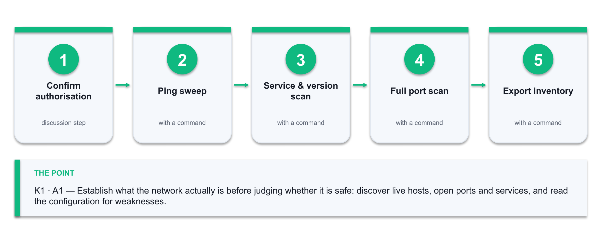

*Figure 1 — the Lab 1 workflow: Confirm authorisation → Ping sweep → Service & version scan → Full port scan → Export inventory.*

**What you'll produce**

A network configuration inventory (host, IP, OS guess, open ports, service versions) plus a written list of the configuration weaknesses you found and why each one matters.   (Tools: Nmap, Zenmap, the IP Calculator (alfredang.github.io/ipcalculator), a spreadsheet, a generative AI assistant.)

**Step-by-step**

1. Confirm you are scanning only the lab network you have been authorised to scan. Never scan a network you do not own or have written permission to test.
2. Before you scan anything, work out exactly what 192.168.56.0/24 covers so your scan scope is defensible. Open the IP Calculator, enter the CIDR, and record the network address, the broadcast address, the usable host range and the host count.

   → <https://alfredang.github.io/ipcalculator/>

3. Discover which hosts are alive on the lab subnet with a ping sweep. Note how many hosts answer, and compare that against the usable host count you just calculated.

   ```bash
   nmap -sn 192.168.56.0/24
   ```

4. Run a service and version scan against the live hosts to learn what each one is actually running.

   ```bash
   nmap -sV -O -T4 192.168.56.0/24 -oN inventory.txt
   ```

5. Scan the full TCP port range on the one host that looks most interesting, so nothing above port 1024 is missed.

   ```bash
   nmap -sV -p- -T4 192.168.56.101 -oN host101-full.txt
   ```

6. Export the scan to a machine-readable form so it can be loaded into a spreadsheet or a script.

   ```bash
   nmap -sV 192.168.56.0/24 -oX inventory.xml
   ```

7. Build the inventory table in a spreadsheet with the columns Host, IP, OS, Open Ports, Services, Versions, Owner, Business Function.
8. Read the inventory for configuration weaknesses. Flag every unencrypted management protocol (Telnet 23, FTP 21, HTTP 80 on an admin interface), every service version that is behind, and every port that has no business being open.
9. Paste the sanitised Nmap output into your AI assistant and ask it to identify the configuration weaknesses and explain the risk of each. Compare its list against yours.

   ```bash
   Prompt: 'Here is Nmap output from a network I am authorised to assess. Identify configuration weaknesses, name the affected protocol or service, and explain the risk of each in one sentence.'
   ```

10. Reconcile the two lists. Record anything the AI found that you missed, and anything it claimed that the evidence does not support — the second list is the more important one.

**Test it — how you know the lab is done**

Your inventory names every live host with its open ports and service versions, and your weakness list contains at least five configuration weaknesses, each tied to specific evidence in the scan output. You can state, for each AI-suggested finding, whether the scan evidence actually supports it.

**If it doesn't work**

No hosts answer the ping sweep — the lab hosts may block ICMP; re-run with `nmap -Pn`. The version scan is slow — narrow the port range with `-p 1-1024` or raise the timing to `-T4`. `-O` reports 'too many fingerprints' — OS detection needs at least one open and one closed port; it is a hint, not evidence.

> **Note:** Only run these techniques against systems you own or are authorised in writing to test. Keep the deliverable from this lab — later labs build on it.

---


### Lab 2 — Baseline Normal Traffic and Detect an Anomaly with AI

Maps to: K1 · K2 · A1 — Learn what 'normal' looks like on a network, then let a machine-learning model tell you when traffic stops being normal.

Goal: Signature detection only finds what someone has already named. This lab builds the other half of the picture. You capture live traffic in Wireshark, turn it into per-connection features, train an unsupervised anomaly-detection model on the quiet 'pattern of life' period, and then score a period that contains a port scan and a data-staging burst. You see for yourself which events the model scores as anomalous and — just as importantly — which normal events it wrongly flags.

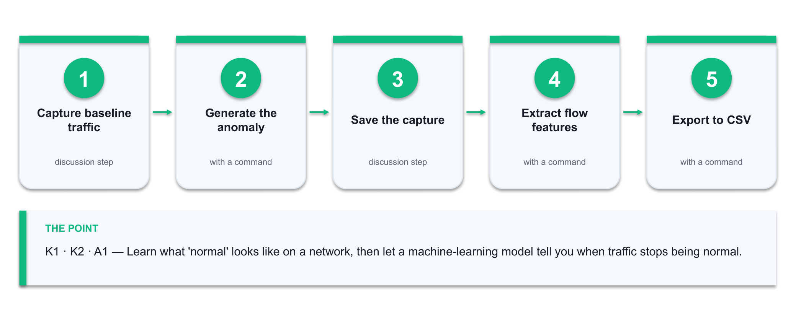

*Figure 2 — the Lab 2 workflow: Capture baseline traffic → Generate the anomaly → Save the capture → Extract flow features → Export to CSV.*

**What you'll produce**

A labelled anomaly report: the connections your Isolation Forest model scored as anomalous, ranked by score, with your own verdict of true positive or false positive against the packet evidence.   (Tools: Wireshark, tshark, the PCAP Analyzer (alfredang.github.io/pcapanalyzer), Python 3, pandas, scikit-learn, a generative AI assistant.)

**Step-by-step**

1. Start a Wireshark capture on the lab interface and leave it running while you browse and use the lab services normally for five minutes. This is your baseline period.
2. While the capture runs, generate the anomalous period: run a port scan against a lab host and then copy a large file across the network.

   ```bash
   nmap -sS -p- 192.168.56.101
   ```

3. Stop the capture and save it as traffic.pcapng.
4. Before writing any code, get a fast read on what you captured. Drag traffic.pcapng into the PCAP Analyzer (it runs entirely in your browser — nothing is uploaded) and note the packet count, capture duration, protocol distribution, top talkers and top conversations.

   → <https://alfredang.github.io/pcapanalyzer/>

5. Write down which conversation you EXPECT the model to flag as anomalous, based on the top-talkers view alone. You will check that prediction against the model's output in step 10 — a human hypothesis first is what stops you rationalising whatever the model happens to say.
6. Export per-connection features from the capture with tshark — source, destination, port, packet count, byte count and duration.

   ```bash
   tshark -r traffic.pcapng -q -z conv,tcp > conversations.txt
   ```

7. Export the same data as CSV for the model to read.

   ```bash
   tshark -r traffic.pcapng -T fields -e ip.src -e ip.dst -e tcp.dstport -e frame.len -e frame.time_relative -E header=y -E separator=, > traffic.csv
   ```

8. Load traffic.csv into pandas and aggregate it per (source, destination, port) conversation: packet count, total bytes, mean packet size and duration.

   ```bash
   python3 baseline.py   # provided in labs/lab-02/
   ```

9. Fit an Isolation Forest on the baseline period only, with a contamination rate of 0.02, then score every conversation in the full capture.

   ```bash
   from sklearn.ensemble import IsolationForest
model = IsolationForest(contamination=0.02, random_state=42).fit(X_baseline)
df['score'] = model.decision_function(X_all)
   ```

10. Sort by score ascending and inspect the twenty most anomalous conversations. Open each one in Wireshark using a display filter and decide what it actually was.

   ```bash
   ip.addr == 192.168.56.101 && tcp.port == 445
   ```

11. Mark each of the twenty as a true positive or a false positive, and write one sentence saying what evidence decided it.
12. Ask your AI assistant to explain the anomalies and suggest which features would separate the scan from the file copy more cleanly. Test one of its suggestions and record whether it improved the result.

   ```bash
   Prompt: 'These network conversations were scored as anomalous by an Isolation Forest. Given packet count, byte count and duration, explain what behaviour each likely represents and suggest one additional feature that would separate port scanning from a legitimate large file transfer.'
   ```


**Test it — how you know the lab is done**

The port scan appears in your top-ranked anomalies — it shows as many short connections from one source to many destination ports. You can name at least one false positive and explain why the model flagged legitimate traffic, and you can state your model's precision on the twenty you reviewed.

**If it doesn't work**

tshark is not found — it ships with Wireshark; on macOS add /Applications/Wireshark.app/Contents/MacOS to PATH. The capture is empty — you may be capturing on the wrong interface; list them with `tshark -D`. Everything scores as anomalous — your baseline period contained the attack traffic; re-cut the baseline to the quiet window only.

> **Note:** Only run these techniques against systems you own or are authorised in writing to test. Keep the deliverable from this lab — later labs build on it.

---


### Lab 3 — AI-Assisted Vulnerability Analysis and Prioritisation

Maps to: K2 · A1 · A2 — Turn a raw vulnerability list into a ranked, defensible worklist by combining CVSS severity with exploitability and business context.

Goal: A scanner will hand you hundreds of findings and no opinion about which one to fix on Monday morning. In this lab you take the service inventory from Lab 1, look up the real CVEs affecting those service versions, and then build a prioritisation that a manager would actually accept: CVSS base score combined with known-exploited status and the business criticality of the affected asset. You use an AI assistant to accelerate the research and then verify every claim it makes against the authoritative source.

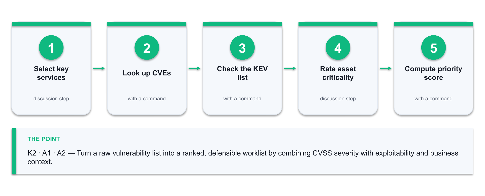

*Figure 3 — the Lab 3 workflow: Select key services → Look up CVEs → Check the KEV list → Rate asset criticality → Compute priority score.*

**What you'll produce**

A prioritised vulnerability worklist: CVE, affected asset, CVSS score, known-exploited flag, asset criticality, computed priority and a one-line recommended fix — ranked, with the top five justified.   (Tools: Nmap service inventory, NVD, CISA KEV catalogue, a spreadsheet, a generative AI assistant.)

**Step-by-step**

1. Take the service-version list from Lab 1. Pick the six most significant services — anything internet-facing, anything running as an administrator, anything holding data.
2. For each service version, search the NIST National Vulnerability Database for matching CVEs and record the CVE ID and CVSS v3 base score.

   → <https://nvd.nist.gov/vuln/search>

3. Check each CVE against the CISA Known Exploited Vulnerabilities catalogue. A CVE on the KEV list is being exploited in the wild right now and outranks a higher CVSS score that is not.

   → <https://www.cisa.gov/known-exploited-vulnerabilities-catalog>

4. Assign each affected asset a business criticality of High, Medium or Low, based on what a loss of confidentiality, integrity or availability would cost. Write the justification in the row.
5. Compute a priority score for every finding so the ranking is reproducible rather than a matter of taste.

   ```bash
   Priority = CVSS x Criticality weight x KEV multiplier
  Criticality: High=1.5, Medium=1.0, Low=0.5
  KEV: on the catalogue=2.0, not on it=1.0
   ```

6. Sort by priority and inspect the top ten. Check that the order matches your professional judgement — if it does not, your weights are wrong, so fix the weights rather than the ranking.
7. Ask your AI assistant to summarise each of your top five CVEs and propose a remediation for each.

   ```bash
   Prompt: 'For each of these CVEs, give the vulnerability class, the attack prerequisite, the practical impact, and the recommended remediation. State the CVSS v3 base score. Flag any CVE you are not certain about.'
   ```

8. Verify every AI-supplied CVSS score and remediation against the NVD entry. Correct anything wrong and note where the AI was inaccurate — this is the evidence that you validated the model rather than trusted it.
9. Write the two-sentence justification for your number-one priority: what could happen, and why it outranks everything else on the list.

**Test it — how you know the lab is done**

Your worklist ranks every finding by a computed priority, not by CVSS alone; a KEV-listed CVE on a high-criticality asset sits above a higher-CVSS finding on a low-criticality one. You can point to at least one AI-supplied detail you corrected against the NVD.

**If it doesn't work**

NVD returns no CVE for a version string — search the product name and major version rather than the full banner. Every finding scores the same — your criticality ratings are all identical; force a spread by ranking assets against each other. The AI invents a CVE ID — this is exactly why step 8 exists; a CVE that is not in the NVD does not exist.

> **Note:** Only run these techniques against systems you own or are authorised in writing to test. Keep the deliverable from this lab — later labs build on it.

---


## Topic 02 — AI-Powered Network Risk Assessment and Management Planning  (25%)

Asset discovery & classification · CIA impact · AI risk scoring · risk registers · treatment plans · NIST CSF & AI RMF

Learning outcome: LO2.  Knowledge assessed: K2.  Abilities assessed: A3, A4.

**Key concepts**

- You cannot protect what you have not inventoried — AI-driven asset discovery continuously fingerprints every identity, device and workload rather than relying on a stale spreadsheet.
- Asset criticality is a business judgement expressed against the CIA triad: what does a loss of confidentiality, integrity or availability actually cost this organisation?
- Risk = Likelihood x Impact. AI improves the likelihood term with exploit-prediction models and threat-intelligence correlation, and improves the impact term with real dependency mapping.
- A risk register is the working artefact of risk management: asset, threat, vulnerability, existing control, inherent risk, treatment, owner, target date and residual risk.
- The four treatment options are mitigate, transfer, avoid and accept — every entry on the register must land on one of them, with a named owner.
- The NIST Cybersecurity Framework (Govern, Identify, Protect, Detect, Respond, Recover) and the NIST AI Risk Management Framework (Govern, Map, Measure, Manage) give the planning scaffold.


### Lab 4 — Build an Asset Register and Classify What Needs Protecting

Maps to: A3 · K1 — Determine which organisational assets require protection, and defend the classification with a business impact judgement rather than a gut feeling.

Goal: Risk management starts with an honest asset register. In this lab you take the network inventory from Lab 1 and turn it into an organisational asset register: you add the owner, the data the asset holds, the business function it serves, and a classification against confidentiality, integrity and availability. You then rank the assets by criticality and use an AI assistant to challenge your classification — because the asset you forgot is the one that gets you.

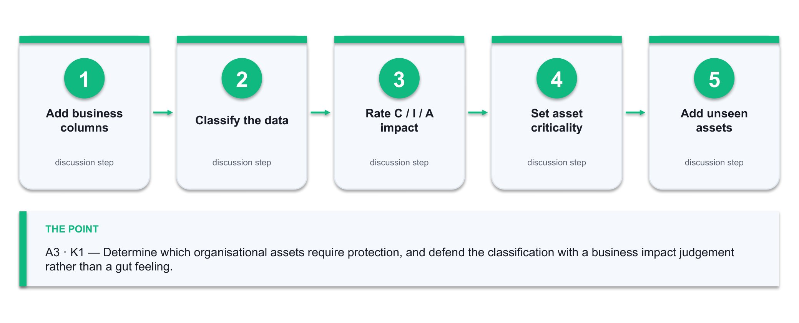

*Figure 4 — the Lab 4 workflow: Add business columns → Classify the data → Rate C / I / A impact → Set asset criticality → Add unseen assets.*

**What you'll produce**

A classified asset register with an owner, data classification and C/I/A impact rating for every asset, ranked by criticality, plus the crown-jewel shortlist.   (Tools: Lab 1 inventory, a spreadsheet, a generative AI assistant.)

**Step-by-step**

1. Open the network inventory from Lab 1 and add the organisational columns: Asset Name, Owner, Business Function, Data Held, Data Classification, Confidentiality Impact, Integrity Impact, Availability Impact, Criticality.
2. Classify the data each asset holds as Public, Internal, Confidential or Restricted. Write the reason in the row — an unjustified classification cannot be defended in a review.
3. Rate the Confidentiality, Integrity and Availability impact of losing each asset as High, Medium or Low. Ask the business question, not the technical one: what would this cost the organisation?
4. Set the asset Criticality to the highest of its three C/I/A ratings. An asset with High availability impact is critical even if its data is public — a payment gateway is the obvious case.
5. Add the assets that a network scan can never see: the people, the paper processes, the third-party services, the backups and the domain registration. These are real assets with real impact.
6. Sort by criticality and identify the crown jewels — the three to five assets whose loss would genuinely damage the organisation.
7. Ask your AI assistant to review your register for gaps.

   ```bash
   Prompt: 'Here is an asset register for a small enterprise network. Identify asset categories I have likely missed, and challenge any criticality rating that looks inconsistent with the stated business function. Do not rewrite my register — list the gaps and the inconsistencies.'
   ```

8. Act on the review: add every legitimate missing asset, and either correct or justify each rating the AI challenged. Record which challenges you accepted and which you rejected, with the reason.
9. Confirm every asset has a named owner. An asset with no owner has no one to accept its risk, which makes the register decorative.

**Test it — how you know the lab is done**

Every row has an owner, a data classification with a reason, three C/I/A ratings and a criticality. Your register includes at least two non-technical assets that no scanner would have found, and you can name your crown jewels and say what makes each one critical.

**If it doesn't work**

Everything is rated High — you are rating the technology, not the business impact; force a ranking by asking which single asset you would restore first. Ownership is unclear — assign the manager of the business function the asset serves, not the system administrator.

> **Note:** Only run these techniques against systems you own or are authorised in writing to test. Keep the deliverable from this lab — later labs build on it.

---


### Lab 5 — AI-Assisted Risk Scoring and the Risk Register

Maps to: A2 · A4 · K4 — Combine the asset register and the vulnerability worklist into a scored risk register, using AI to sharpen the likelihood estimate.

Goal: A risk is not a vulnerability. A risk is a threat exploiting a vulnerability against an asset, with a likelihood and an impact. In this lab you join Lab 3's vulnerabilities to Lab 4's assets to produce a proper risk register, score each entry on a 5x5 likelihood-impact matrix, and use an AI assistant to pressure-test your likelihood estimates against current threat intelligence. You end with a heat map that shows management where the real exposure is.

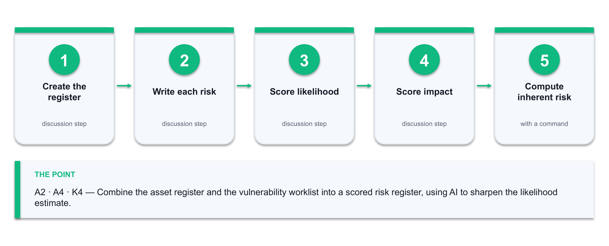

*Figure 5 — the Lab 5 workflow: Create the register → Write each risk → Score likelihood → Score impact → Compute inherent risk.*

**What you'll produce**

A scored risk register with inherent risk, existing controls and residual risk for every entry, plus a 5x5 heat map showing the distribution.   (Tools: Lab 3 worklist, Lab 4 asset register, the Cybersecurity Simulator (alfredang.github.io/cybersecuritysimulator), a spreadsheet, a generative AI assistant.)

**Step-by-step**

1. Create the risk register with the columns Risk ID, Asset, Threat, Vulnerability, Existing Controls, Likelihood (1-5), Impact (1-5), Inherent Risk, Treatment, Owner, Target Date, Residual Risk.
2. Write each risk as a full sentence before you score it: 'A [threat actor] exploits [vulnerability] on [asset], resulting in [consequence].' A risk you cannot phrase this way is not yet a risk.
3. Before you score likelihood from a spreadsheet, see the attacks work. Open the Cybersecurity Simulator and run the Phishing, SQL Injection and Social Engineering modules — note for each how little the attacker needs and how plausible the lure is. Likelihood is a judgement about human and technical reality, not a number you invent.

   → <https://alfredang.github.io/cybersecuritysimulator/>

4. Use the simulator's Password Strength Lab to test three passwords of the kind your organisation actually allows. Record the estimated crack time — that figure is the evidence behind any credential-attack likelihood score you write.

   → <https://alfredang.github.io/cybersecuritysimulator/>

5. Score Likelihood 1-5 using evidence — is the vulnerability on the CISA KEV list, is the asset internet-facing, is there a public exploit, does an existing control reduce the chance, and what did the simulator show you about how easily this attack lands?
6. Score Impact 1-5 from the asset's criticality in Lab 4, adjusted for what this specific threat would actually do to it.
7. Compute Inherent Risk as Likelihood x Impact, and band it: 1-4 Low, 5-9 Medium, 10-14 High, 15-25 Critical.

   ```bash
   Inherent Risk = Likelihood × Impact
   ```

8. Record the controls already in place for each risk, then re-score to get Residual Risk. The gap between inherent and residual is exactly what your existing controls are buying you.
9. Ask your AI assistant to challenge your likelihood scores against current threat activity.

   ```bash
   Prompt: 'Here is a risk register with likelihood scores from 1 to 5. For each risk, state whether current threat intelligence suggests my likelihood is too high, too low or about right, and give the reason. Note where you are uncertain.'
   ```

10. Adjust the scores you agree with and document the ones you rejected. A risk register that is never challenged is a risk register nobody believes.
11. Build the 5x5 heat map — likelihood on one axis, impact on the other, each cell counting the risks that land in it — and identify which quadrant carries your exposure.
12. Sort by residual risk and confirm the top five are the risks you would genuinely lose sleep over. If they are not, your scoring is wrong.

**Test it — how you know the lab is done**

Every risk is written as a complete threat-vulnerability-asset-consequence sentence and carries both an inherent and a residual score. Your heat map shows a real spread rather than everything clustered in one cell, and you can justify your top five to a manager.

**If it doesn't work**

Inherent and residual are identical everywhere — you have not recorded the existing controls. All risks land in the same band — your 1-5 scales are being used as 3-4; force the extremes. The AI is confidently wrong about a threat — treat its output as a prompt to check the source, never as the source.

> **Note:** Only run these techniques against systems you own or are authorised in writing to test. Keep the deliverable from this lab — later labs build on it.

---


### Lab 6 — Develop the Risk Management Plan

Maps to: A4 · K4 — Turn the scored register into a risk management plan with treatments, owners, dates and a monitoring cadence that survives contact with reality.

Goal: A register records risk; a plan does something about it. In this lab you assign each risk one of the four treatments — mitigate, transfer, avoid or accept — select the specific controls that implement the mitigation, name an owner and a target date for each, and map the whole plan onto the NIST Cybersecurity Framework functions so that the coverage gaps become visible. You then use AI to draft the management summary and you edit it into something you would actually sign.

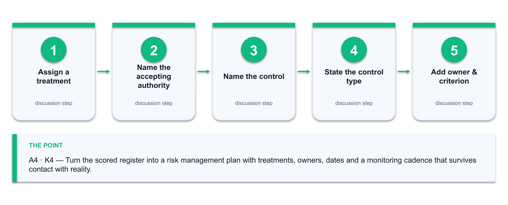

*Figure 6 — the Lab 6 workflow: Assign a treatment → Name the accepting authority → Name the control → State the control type → Add owner & criterion.*

**What you'll produce**

A risk management plan: treatment decisions with named controls, owners, target dates and success criteria; a NIST CSF coverage map; and a one-page management summary.   (Tools: Lab 5 risk register, NIST CSF 2.0, a spreadsheet, a generative AI assistant.)

**Step-by-step**

1. Assign each risk in the register one of the four treatments — Mitigate, Transfer, Avoid or Accept. Every risk gets exactly one; nothing may be left blank.
2. Every Accept decision needs a named accepting authority and a written rationale. An accepted risk with no name against it is an ignored risk.
3. For each Mitigate decision, name the specific control that will reduce the risk — not 'improve security', but 'disable Telnet on the three switches and enforce SSHv2 with key authentication'.
4. State the control type for each: preventive, detective or corrective. A plan made only of detective controls will find every breach and stop none of them.
5. Add an owner, a target date and a success criterion to every treatment. The success criterion must be testable — 'no Telnet listener on any managed switch, verified by Nmap' is testable; 'switches hardened' is not.
6. Map every planned control onto the NIST CSF 2.0 functions — Govern, Identify, Protect, Detect, Respond, Recover — and count the controls in each. The thin function is your real gap.

   → <https://www.nist.gov/cyberframework>

7. Fill the thinnest function with at least one concrete control. Most first-draft plans are heavy on Protect and empty on Recover.
8. Set the monitoring cadence: which risks are reviewed monthly, which quarterly, and what event forces an out-of-cycle review.
9. Ask your AI assistant to draft a one-page management summary of the plan for a non-technical audience.

   ```bash
   Prompt: 'Summarise this risk management plan for a non-technical executive in under 400 words: the top three exposures in business terms, what we are doing about each, what it needs, and what happens if we do nothing. No jargon.'
   ```

10. Edit the draft hard. Cut anything the register does not support, and add the one thing the AI could not know — what this actually costs and who has to approve it.

**Test it — how you know the lab is done**

Every risk carries a treatment, and every Mitigate carries a named control, an owner, a date and a testable success criterion. Your NIST CSF map has at least one control under all six functions, and the management summary states the top three exposures in business language without jargon.

**If it doesn't work**

Everything is Mitigate — some risks are genuinely cheaper to accept or transfer; a plan that mitigates everything will be funded for nothing. Success criteria are unverifiable — rewrite each one as a test someone could run. Recover is empty — add backup restoration testing.

> **Note:** Only run these techniques against systems you own or are authorised in writing to test. Keep the deliverable from this lab — later labs build on it.

---


## Topic 03 — Designing and Implementing AI-Enhanced Network Security Measures  (30%)

Defence in depth · planning/building/management phases · segmentation & zero trust · AI firewalls, IDS/IPS, NAC · AI security itself

Learning outcome: LO3.  Knowledge assessed: K3.  Abilities assessed: A5, A6, A7.

**Key concepts**

- Defence in depth layers physical, technical and administrative controls so that the failure of any single control does not become a breach.
- Network security design runs in three phases — planning (requirements, risk, architecture), building (configure, harden, test) and management (monitor, tune, review).
- Segmentation and zero trust shrink the blast radius: VLANs, DMZs and micro-segmentation stop lateral movement, and 'never trust, always verify' removes implicit network trust.
- AI-powered firewalls and NGFW policy engines adapt rule sets to observed traffic instead of relying purely on static, hand-written rules.
- AI-enhanced IDS/IPS, UEBA and adaptive access control score every session on device, behaviour, location and time, and step up authentication when risk rises.
- The AI you deploy is itself an asset to defend — NIST AI 100-2 catalogues evasion, poisoning, privacy and misuse attacks, and the NSA/CISA guidance tells you how to deploy AI securely.


### Lab 7 — Design the Layered Architecture Across the Three Security Phases

Maps to: A5 · K3 — Define the planning, building and management phases for a network security design, and express the design as layered defence-in-depth controls.

Goal: Security design is a phased engineering activity, not a shopping list. In this lab you take the risk management plan from Lab 6 and produce an actual design: you write the requirements and constraints in the planning phase, draw a segmented target architecture with the controls placed at each layer, and define the management phase that keeps the design honest after go-live. You use an AI assistant as a design reviewer and then defend the design against its objections.

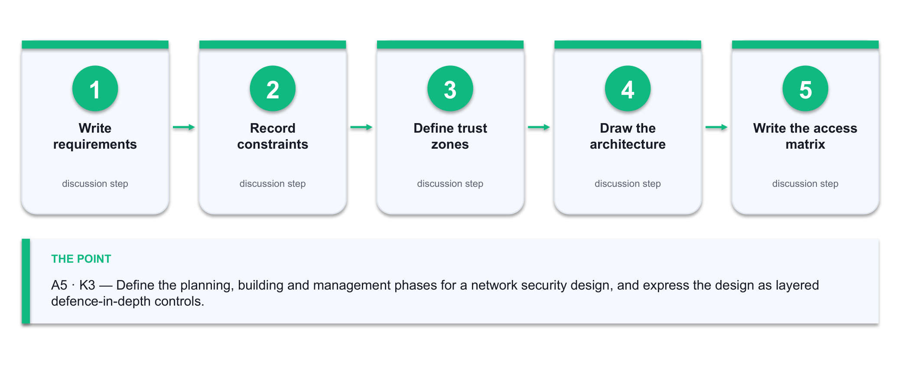

*Figure 7 — the Lab 7 workflow: Write requirements → Record constraints → Define trust zones → Draw the architecture → Write the access matrix.*

**What you'll produce**

A three-phase security design: a planning-phase requirements table, a segmented target architecture diagram with controls at every layer, and a management-phase operating model.   (Tools: Lab 6 plan, the IP Calculator (alfredang.github.io/ipcalculator), a diagramming tool (draw.io or paper), a generative AI assistant.)

**Step-by-step**

1. Planning phase — write the security requirements the design must satisfy, each traced back to a specific risk ID from Lab 5. A requirement with no risk behind it is a preference.
2. Planning phase — record the constraints: budget, existing equipment, skills available, downtime tolerance and any regulatory obligation. Constraints are what make a design real.
3. Planning phase — define the trust zones: Internet, DMZ, internal user network, server network, management network and any OT or guest segment. State what each zone is allowed to reach.
4. Planning phase — turn those zones into real address space. Use the IP Calculator's recursive subnet splitting to carve your allocation into one subnet per zone, sized to the hosts each actually needs. Record the CIDR, usable range and host count per zone — a segmentation design with no addressing plan cannot be implemented.

   → <https://alfredang.github.io/ipcalculator/>

5. Building phase — draw the target architecture with the zones as segments and place the controls at each layer: perimeter firewall, DMZ, internal segmentation, host controls and data controls.
6. Building phase — write the zone-to-zone access matrix. Rows are source zones, columns are destination zones, cells hold the permitted protocols. Default deny: every empty cell is blocked.
7. Building phase — classify every control you have placed as physical, technical or administrative, and confirm you have all three. A design with no administrative controls has no way to stay correct.
8. Management phase — define what happens after go-live: who monitors what, the review cadence, the change-control path, and the trigger that forces a redesign.
9. Ask your AI assistant to review the design as an attacker would.

   ```bash
   Prompt: 'Here is a segmented network security design with a zone access matrix. Acting as an attacker, describe three paths you would take through this architecture and name the control that would have to fail at each step. Then identify the weakest zone boundary.'
   ```

10. Answer each attack path in writing: either add a control that closes it, or record why the residual risk is acceptable and who accepts it.
11. Trace every High and Critical risk from Lab 5 to at least one control in the design. Any risk with no control is either untreated or was accepted — and it must say which.

**Test it — how you know the lab is done**

Every security requirement traces to a risk ID, the access matrix is default-deny with justified exceptions, all three control categories are present, and every High or Critical risk maps to a control or a documented acceptance. You can answer all three of the AI's attack paths.

**If it doesn't work**

The matrix has more allow cells than deny — you are documenting today's flat network rather than designing a segmented one. No management phase — a design with no operating model degrades within a quarter. The AI's attack paths seem unrealistic — say why in writing; that reasoning is the deliverable.

> **Note:** Only run these techniques against systems you own or are authorised in writing to test. Keep the deliverable from this lab — later labs build on it.

---


### Lab 8 — Implement AI-Enhanced Controls — Firewall Policy, IDS and Adaptive Access

Maps to: A6 · K3 — Develop the security measures for the network components: build a default-deny firewall policy, tune detection rules, and specify adaptive AI-driven access control.

Goal: This is where the design becomes configuration. You write a default-deny firewall ruleset from the Lab 7 access matrix, run detection against real traffic to see what your rules actually catch, and specify the risk-based conditions under which an AI-driven access control should step up authentication or block outright. You then compare a static rule against a behavioural model on the same traffic — and see exactly where each one wins.

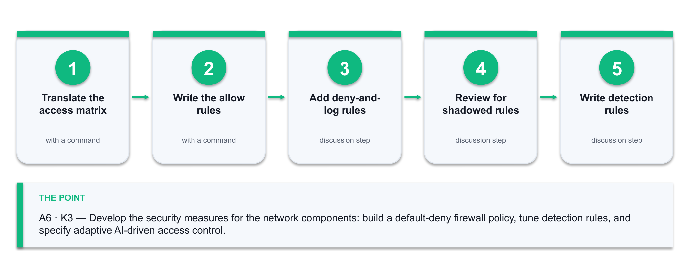

*Figure 8 — the Lab 8 workflow: Translate the access matrix → Write the allow rules → Add deny-and-log rules → Review for shadowed rules → Write detection rules.*

**What you'll produce**

A default-deny firewall ruleset derived from the access matrix, a tuned detection ruleset with its true/false positive counts, and an adaptive access-control policy specification.   (Tools: Firewall rule syntax (iptables or a NGFW policy table), the Cryptography Toolkit (alfredang.github.io/cryptography-toolkit), Wireshark, Python, a generative AI assistant.)

**Step-by-step**

1. Translate the Lab 7 access matrix into an ordered firewall ruleset. Specific allow rules first, the default deny last — order is the whole game in a firewall.

   ```bash
   # Rule 1: allow established return traffic
iptables -A FORWARD -m state --state ESTABLISHED,RELATED -j ACCEPT
# Rule N: default deny (must be last)
iptables -P FORWARD DROP
   ```

2. Write each allow rule with source zone, destination zone, protocol, port, and a comment naming the business reason. An uncommented rule becomes permanent because nobody dares delete it.

   ```bash
   iptables -A FORWARD -s 10.0.10.0/24 -d 10.0.30.0/24 -p tcp --dport 443 -j ACCEPT -m comment --comment 'Users to app servers HTTPS - REQ-004'
   ```

3. Add explicit deny-and-log rules for the traffic you most want to know about — management protocols crossing a zone boundary, and any outbound connection from the server zone.
4. Review the ruleset for shadowed rules: any rule that can never match because an earlier rule already covers its traffic. Shadowed rules are the most common firewall defect there is.
5. Your ruleset controls WHO may connect; encryption controls what an interceptor can read. Use the Cryptography Toolkit to encrypt a sample management credential with AES-256 (CBC), then decrypt it. Then try the same string with DES and RC4 — both are flagged insecure for a reason. Record why your design mandates AES for management traffic.

   → <https://alfredang.github.io/cryptography-toolkit/>

6. Now the detection layer. Write three detection rules against the Lab 2 capture — one for a port scan, one for a large outbound transfer, and one for a connection to a management port from a user subnet.
7. Run each rule over the capture and count the true positives and false positives. A rule with more false positives than true is worse than no rule, because it trains the analyst to ignore alerts.

   ```bash
   tshark -r traffic.pcapng -Y 'tcp.flags.syn==1 && tcp.flags.ack==0' -T fields -e ip.src | sort | uniq -c | sort -rn
   ```

8. Compare the static rule against the Lab 2 anomaly model on the same traffic. Record where the rule wins (precision on known patterns) and where the model wins (unnamed behaviour).
9. Specify the adaptive access-control policy: the signals (device posture, location, time, behaviour deviation, resource sensitivity), the risk bands, and the action at each band — allow, step-up MFA, restrict, or block.
10. State the human-in-the-loop boundary explicitly. Which actions may the system take autonomously, and which require a named person to approve? Automatic blocking of a production server needs an owner.
11. Ask your AI assistant to review the firewall ruleset for shadowed rules, overly broad allows and missing egress controls, then verify each finding by reading the rule yourself.

   ```bash
   Prompt: 'Review this ordered firewall ruleset. Identify shadowed rules that can never match, allow rules that are broader than their stated business reason, and any missing egress control. Quote the rule number for each finding.'
   ```


**Test it — how you know the lab is done**

Your ruleset ends in an explicit default deny, every allow rule carries a business-reason comment traced to a requirement, and you have no shadowed rules. You can state the true/false positive count for each detection rule and say which of the static rule or the AI model you would deploy for each of the three detections, and why.

**If it doesn't work**

The default deny is not last — everything after it is dead code. All traffic is blocked — you are missing the ESTABLISHED,RELATED rule, so return traffic never gets back. The detection rule fires constantly — your threshold is tuned to a quiet lab, not to production; raise it against the baseline.

> **Note:** Only run these techniques against systems you own or are authorised in writing to test. Keep the deliverable from this lab — later labs build on it.

---


### Lab 9 — Secure the AI Itself — Adversarial ML and the NSA/CISA Deployment Controls

Maps to: A5 · A6 · A7 · K3 — Recognise that the AI you deploy is an attack surface, and apply the recognised controls for deploying an AI system securely.

Goal: Every previous lab used AI as a defensive tool. This one turns the question around: what happens when the AI is the target? You run an evasion attack against your own Lab 2 anomaly model and watch it go blind, simulate a poisoning attack on its training data, then work through the NIST AI 100-2 attack taxonomy and the NSA/CISA 'Deploying AI Systems Securely' controls to produce a hardening checklist for the AI components in your Lab 7 design.

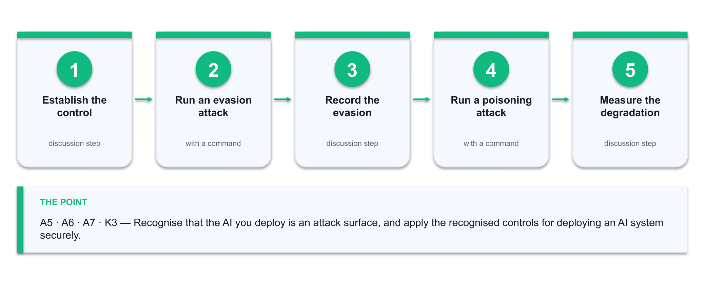

*Figure 9 — the Lab 9 workflow: Establish the control → Run an evasion attack → Record the evasion → Run a poisoning attack → Measure the degradation.*

**What you'll produce**

A demonstrated evasion and a demonstrated poisoning attack against your own model, plus an AI security hardening checklist mapped to the NSA/CISA three categories and the NIST AI 100-2 attack classes.   (Tools: Lab 2 model, Python, scikit-learn, NIST AI 100-2e2025, NSA/CISA CSI, MITRE ATLAS.)

**Step-by-step**

1. Reload your Lab 2 Isolation Forest and confirm it still detects the port scan. This is your control condition — you cannot show an attack worked without it.
2. Evasion attack: slow the scan down. Regenerate the scan features with a long inter-packet delay so the connection rate falls inside the baseline, then re-score it.

   ```bash
   nmap -sS -T1 --scan-delay 5s -p 1-1024 192.168.56.101
   ```

3. Record what happened. The traffic is functionally identical, the intent is identical, and the model no longer flags it — that is an evasion attack, and it needed no access to the model at all.
4. Poisoning attack: inject slow-scan traffic into the training window, refit the model, and re-score the original fast scan. Measure how far the detection degrades.

   ```bash
   X_poisoned = np.vstack([X_baseline, X_slowscan])
model_p = IsolationForest(contamination=0.02, random_state=42).fit(X_poisoned)
   ```

5. Record the degradation as a number — detection rate before poisoning versus after. 'The model got worse' is an anecdote; a measured drop is evidence.
6. Map both attacks onto the NIST AI 100-2e2025 taxonomy — evasion, poisoning, privacy and misuse — and state which class each belongs to and at what stage of the ML lifecycle it lands.

   → <https://csrc.nist.gov/pubs/ai/100/2/e2025/final>

7. Look up the matching tactics and techniques in MITRE ATLAS, the adversarial threat knowledge base for AI systems, and note the mitigations it lists.

   → <https://atlas.mitre.org/>

8. Work through the NSA/CISA 'Deploying AI Systems Securely' controls under its three categories — secure the deployment environment, continuously protect the AI system, and secure AI operation and maintenance.

   → <https://www.cisa.gov/news-events/alerts/2024/04/15/joint-guidance-deploying-ai-systems-securely>

9. Add the CISA/NSA AI data-security controls that protect the training pipeline: data provenance tracking, cryptographic integrity verification, digital signatures on dataset revisions, access control by classification, encryption in transit and at rest, and continuous risk assessment.
10. Produce the hardening checklist for the AI components in your Lab 7 design. Every item names the control, the attack class it addresses, who owns it and how it is verified.
11. Add the one control that no framework will hand you: define what the security operation does when the AI is unavailable or untrusted. A detection capability with no manual fallback is a single point of failure.

**Test it — how you know the lab is done**

You can demonstrate the slowed scan evading a model that detected the fast one, and you can state the measured detection drop after poisoning. Your checklist covers all three NSA/CISA categories, names an owner and a verification method for every control, and includes a stated fallback for when the AI is down.

**If it doesn't work**

The slow scan is still detected — your feature set does not include a rate term, so slowing it changes nothing; add connections-per-second and retry. Poisoning shows no effect — your injected sample is too small relative to the baseline; raise the proportion and re-measure. Results vary between runs — set random_state so the comparison is fair.

> **Note:** Only run these techniques against systems you own or are authorised in writing to test. Keep the deliverable from this lab — later labs build on it.

---


## Topic 04 — AI-Assisted Security Incident Documentation and Response  (20%)

Logging & syslog · SIEM/SOAR · AI alert triage · the NIST IR lifecycle · incident documentation · playbooks & post-incident review

Learning outcome: LO4.  Knowledge assessed: K4.  Abilities assessed: A8, A9.

**Key concepts**

- Logging is the evidence base of incident response — syslog, Windows Event Log, flow records and firewall logs must be centralised, time-synchronised and retained.
- SIEM correlates events into incidents; SOAR executes the response playbook — isolate the host, revoke the credential, block the address — at machine speed.
- AI alert triage attacks the real bottleneck: it deduplicates, clusters and contextualises so the analyst sees a handful of ranked incidents instead of thousands of raw alerts.
- The NIST SP 800-61 lifecycle is Preparation, Detection & Analysis, Containment/Eradication/Recovery, and Post-Incident Activity — AI accelerates each step but owns none of them.
- An incident record must state what happened, when, to which assets, the severity, the actions taken, the evidence, and the person accountable — this is the A8 deliverable.
- Human-in-the-loop approval remains mandatory for destructive or wide-blast-radius actions; AI recommends, a named responder decides.


### Lab 10 — Centralise Logs and Triage Alerts with AI

Maps to: A7 · K4 — Design the auditing arrangement that makes incident response possible, then use AI to reduce a flood of raw alerts into a ranked, workable queue.

Goal: Incident response is only as good as the evidence available when it starts. In this lab you define what must be logged and for how long, work with a realistic multi-source log set, and then attack the actual bottleneck of a security operation: alert volume. You deduplicate, cluster and enrich the alerts, use an AI assistant to rank them and explain its reasoning, and then measure whether the ranking was any good.

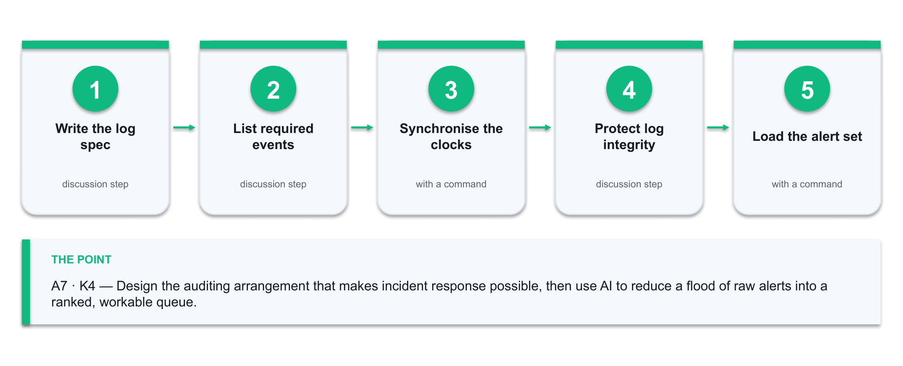

*Figure 10 — the Lab 10 workflow: Write the log spec → List required events → Synchronise the clocks → Protect log integrity → Load the alert set.*

**What you'll produce**

A logging and audit specification, plus a triaged alert queue ranked by priority with an AI-generated rationale for each and your own verification of the top ten.   (Tools: syslog, Windows Event Log, RegexLab (alfredang.github.io/regexgenerator), Python, pandas, a generative AI assistant.)

**Step-by-step**

1. Write the logging specification: for each asset class name the log source, the events that must be captured, the retention period and where the log is centralised.
2. Include the events that matter for investigation — authentication success and failure, privilege escalation, configuration change, firewall deny, and process or service creation. A log of only failures cannot reconstruct an intrusion.
3. Specify time synchronisation. Every source must use NTP against the same reference, because a correlation across sources with skewed clocks is worthless.

   ```bash
   timedatectl set-ntp true && timedatectl status
   ```

4. Confirm the log integrity controls: append-only or write-once storage, restricted access, and forwarding off the host — an attacker with local admin will clear the local log first.
5. Load the provided multi-source alert set into pandas and look at the raw volume. This is the problem the rest of the lab solves.

   ```bash
   python3 triage.py   # provided in labs/lab-10/
   ```

6. Before filtering at scale, build the pattern and prove it works. Paste a representative log line into RegexLab, write a regex that extracts the source IP and the event type, and check the live match count and the match explanation. A filter you have not tested against real lines is how a triage pipeline silently drops evidence.

   → <https://alfredang.github.io/regexgenerator/>

7. Use the same tool to write a pattern that catches authentication FAILURES but not successes, then deliberately test it against a success line to confirm it does not match. Record both results — the negative test is the one that matters.

   → <https://alfredang.github.io/regexgenerator/>

8. Deduplicate: collapse identical alerts on the same source, destination and signature within a time window into one alert with a count. Record how much this alone reduces the queue.

   ```bash
   df.groupby(['src','dst','signature']).agg(count=('ts','size'), first=('ts','min'), last=('ts','max'))
   ```

9. Cluster the remaining alerts by source and by time so that a burst from one host reads as one incident rather than forty unrelated events.
10. Enrich each cluster with context from your earlier labs — the asset criticality from Lab 4 and the risk score from Lab 5. Context is what turns an alert into a priority.
11. Ask your AI assistant to rank the clusters and explain each ranking.

   ```bash
   Prompt: 'Here are deduplicated, enriched security alert clusters with asset criticality. Rank them by investigation priority. For each, state the likely attack technique, the evidence supporting it, and what a responder should check first. Flag any cluster where the evidence is ambiguous.'
   ```

12. Verify the top ten yourself against the raw logs. Count how many were genuinely high priority — that number is your triage precision, and it is what you report.
13. Write down the two alert types the AI ranked poorly and say what context it was missing. That gap is the enrichment you add next time.

**Test it — how you know the lab is done**

Your logging specification names the source, events, retention and central destination for every asset class. Deduplication and clustering reduce the queue by a measurable percentage that you can state, and you can report the triage precision of the top ten with the evidence that decided each one.

**If it doesn't work**

Deduplication removes real incidents — your window is too wide; a repeated login failure over hours is a different event from forty in ten seconds. Everything ranks as critical — the asset-criticality join failed and every alert inherited the default. Timestamps do not line up — sources are in different time zones; normalise to UTC before correlating.

> **Note:** Only run these techniques against systems you own or are authorised in writing to test. Keep the deliverable from this lab — later labs build on it.

---


### Lab 11 — Document a Security Incident to the Standard

Maps to: A8 · K4 — Produce an incident record that is complete enough to hand to a manager, an auditor or a regulator without a conversation attached.

Goal: An incident that is badly documented is an incident that teaches nothing and proves nothing. Working from the top-priority cluster in Lab 10, you reconstruct the timeline from the raw evidence, classify the severity against defined criteria, and write the full incident record: what happened, when, to which assets, what was done, what the evidence is and who was accountable. You use AI to draft the narrative and then you correct it against the log — because the draft will confidently state things the evidence does not.

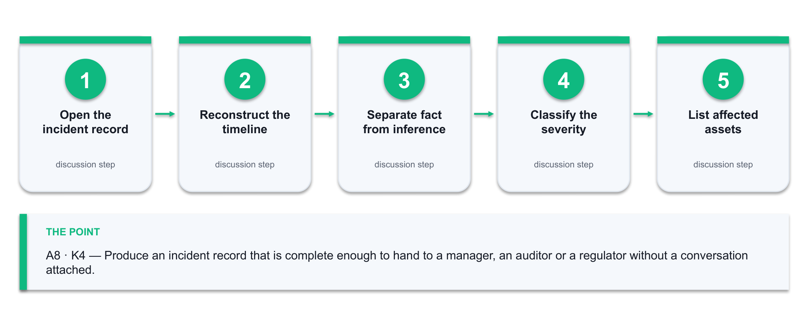

*Figure 11 — the Lab 11 workflow: Open the incident record → Reconstruct the timeline → Separate fact from inference → Classify the severity → List affected assets.*

**What you'll produce**

A complete incident record with a reconstructed evidence-based timeline, a justified severity classification, the actions taken, the evidence inventory and the notification decisions.   (Tools: Lab 10 alert queue and raw logs, the PCAP Analyzer and Cryptography Toolkit, NIST SP 800-61, an incident record template, a generative AI assistant.)

**Step-by-step**

1. Open an incident record and fill the header: incident ID, date and time of detection, detected by, reporter, current status and the assigned handler.
2. Reconstruct the timeline from the raw logs in UTC. Every entry needs a timestamp, the event, the source system and the log line that proves it. A timeline entry with no evidence reference is a claim, not a finding.
3. Separate what you know from what you infer. Write inferences as inferences — 'the account was used from an unrecognised address, which suggests credential compromise' is honest; stating the compromise as fact is not.
4. Classify the severity against written criteria: assets affected, data classification involved, business impact and whether the activity is ongoing. State the criteria you applied so the rating can be reviewed.
5. List the affected assets by name from the Lab 4 register, with their criticality and the data classification each one holds.
6. Record the response actions taken with a timestamp and the name of the person who took each one. Include the actions that were considered and rejected, and why — a reviewer will ask.
7. If a packet capture is part of your evidence, summarise it before you cite it. Open it in the PCAP Analyzer and record the capture window, the packet and byte counts, and the conversations involving the affected asset — that summary is what a reader who cannot open a pcap actually needs.

   → <https://alfredang.github.io/pcapanalyzer/>

8. Build the evidence inventory: log extracts, packet captures, screenshots and system images, each with where it is stored, its hash and who has access. This is what makes the record defensible.

   ```bash
   shasum -a 256 evidence/*.pcapng evidence/*.log > evidence/MANIFEST.sha256
   ```

9. Confirm you understand what that hash proves. Put the same text into the Cryptography Toolkit twice and check the digest is identical, then change one character and check it is completely different. That property — and only that property — is what makes your evidence manifest tamper-evident.

   → <https://alfredang.github.io/cryptography-toolkit/>

10. Record the notification decisions — who was informed, when, and which obligations were considered. In Singapore, consider whether the PDPA data-breach notification obligation to the PDPC and affected individuals is engaged, and record the reasoning either way.
11. Ask your AI assistant to draft the incident narrative from your timeline.

   ```bash
   Prompt: 'Draft a factual incident narrative from this evidence timeline. Use only what the timeline supports. Mark every inference explicitly as an inference. Do not speculate about attribution.'
   ```

12. Check the draft line by line against the timeline. Delete every statement the evidence does not support and every attribution claim. Record what you removed — that edit is the professional skill this lab teaches.
13. Write the lessons-learned section: what detected it, what delayed the response, and the one control change that would have prevented or caught it earlier. Feed that change back into the Lab 6 plan.

**Test it — how you know the lab is done**

Every timeline entry cites its evidence source, inferences are marked as inferences, the severity classification states the criteria used, and the evidence inventory carries a hash for every item. You can name at least one unsupported statement you removed from the AI draft.

**If it doesn't work**

The timeline has gaps — that is a finding about your logging, so record the gap rather than guessing what filled it. Severity is contested — that means the criteria were not written down before the incident. The AI names an attacker group — remove it; attribution needs intelligence you do not have.

> **Note:** Only run these techniques against systems you own or are authorised in writing to test. Keep the deliverable from this lab — later labs build on it.

---


### Lab 12 — Implement the Incident Response Configuration and Playbook

Maps to: A9 · A7 · K4 — Implement configurations aligned to the incident response design: containment controls, an automated playbook and the human-approval boundary.

Goal: The final lab closes the loop. You take the incident from Lab 11 and implement the response as configuration: the containment controls that would stop it recurring, a documented SOAR-style playbook with explicit automation and approval steps, and detection rules derived from what you actually saw. You then test the playbook against a replayed scenario, measure the response time, and confirm that no automated action can cause more damage than the incident it responds to.

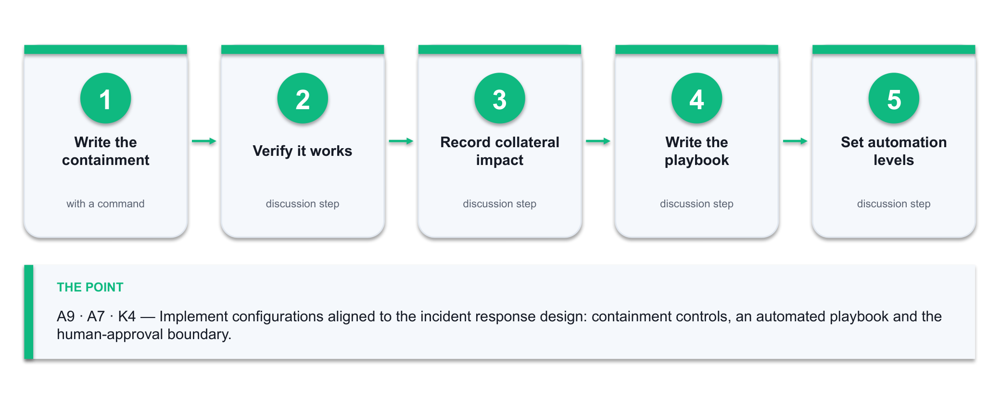

*Figure 12 — the Lab 12 workflow: Write the containment → Verify it works → Record collateral impact → Write the playbook → Set automation levels.*

**What you'll produce**

Implemented containment configurations, a tested incident response playbook with a defined human-approval boundary, new detection rules, and a measured response time from detection to containment.   (Tools: Firewall and host configuration, playbook template, Lab 8 detection rules, a generative AI assistant.)

**Step-by-step**

1. Write the containment configuration for the Lab 11 incident: the firewall rules, account actions and host isolation steps that stop this specific attack path, as commands rather than prose.

   ```bash
   iptables -I FORWARD 1 -s 192.168.56.101 -j DROP -m comment --comment 'INC-2026-001 containment'
   ```

2. Verify each containment control actually works, and record the verification command and its output. An untested containment control is an assumption.
3. Record the collateral impact of each containment action before it is ever needed. Isolating a host stops the attacker and also stops that host's business function — the responder must know which they are trading.
4. Write the playbook with the standard phases: Detect, Triage, Contain, Eradicate, Recover, Review. Each step names the trigger, the action, the owner and the expected duration.
5. Mark each step Automated, Automated-with-approval or Manual. Reversible, low-blast-radius actions can be automated; anything that takes production offline needs a named approver.
6. Define the escalation path with names and contact methods, and the time threshold that triggers each escalation. A playbook with no named person is a document, not a capability.
7. Add the detection rules from this incident to your Lab 8 ruleset so the same attack is caught earlier next time, and record the expected false-positive rate of each new rule.
8. Test the playbook against a replayed scenario. Walk every step, time it, and note where it stalls — the stall is where the playbook is wrong.
9. Measure detection-to-containment time and compare it against your target. If there is no target, set one now — a response time nobody is accountable for will drift.
10. Ask your AI assistant to review the playbook for gaps and dangerous automation.

   ```bash
   Prompt: 'Review this incident response playbook. Identify missing steps, any automated action whose blast radius exceeds the incident it responds to, and any step with no named owner. For each finding, say what you would change.'
   ```

11. Fix every genuine gap. For any automated action flagged as too broad, either narrow its scope or move it behind human approval, and record the decision.
12. Feed the whole result back: update the Lab 6 risk management plan with the control changes and re-score the affected risks. The loop from incident back to plan is what makes this a management system rather than a set of documents.

**Test it — how you know the lab is done**

Every containment control has a verification command and a recorded output, every playbook step names an owner and an automation level, and you can state a measured detection-to-containment time against a target. No automated step can take a production service offline without a named approver.

**If it doesn't work**

The containment rule does not take effect — check the rule order; an earlier ACCEPT will win. The playbook test stalls waiting for a decision — that is the finding, so add the decision authority. The AI proposes automating everything — apply the blast-radius test yourself; that judgement is not delegable.

> **Note:** Only run these techniques against systems you own or are authorised in writing to test. Keep the deliverable from this lab — later labs build on it.

---


## Assessment Preparation

**What the assessment consists of**

- Written Assessment — Short-Answer Questions (WA-SAQ) · 1 hour · open book. Assesses the underpinning knowledge K1–K4.
- Case Study (CS) · 1 hour · open book. Assesses the abilities A1–A9 against a realistic organisational scenario.
- Both instruments are open book: you may use these course slides, this Learner Guide and approved materials only.
- You are assessed as Competent (C) or Not Yet Competent (NYC) on each instrument. An NYC in any K or A results in an NYC for the unit.
- A minimum of 75% attendance is required to be eligible for assessment and funding.

**Preparing for the Written Assessment (K1–K4)**

- K1 — be able to describe an ICT network's components and configuration, and explain what a given configuration weakness exposes. Revise Topic 1 and your Lab 1 inventory.
- K2 — be able to name and describe the main classes of network attack and the vulnerabilities they exploit, including why polymorphic and Living-off-the-Land techniques defeat signature detection. Revise Topic 1 and Topic 2.
- K3 — be able to describe the types and techniques of network security measures across the physical, technical and administrative categories, and the preventive/detective/corrective distinction. Revise Topic 3.
- K4 — be able to explain how a risk management plan is built and how incident response procedures are structured, including the NIST SP 800-61 lifecycle. Revise Topics 2 and 4.
- Practise writing short, complete answers: state the point, then justify it with a reason or an example. A one-word answer rarely evidences the knowledge.

**Preparing for the Case Study (A1–A9)**

The Case Study presents a realistic organisational scenario and asks you to work through the same chain you practised in the labs. The most reliable preparation is to redo the chain end to end on your own lab network, from memory, and check that each deliverable still comes out complete.

- A1, A2 — identify the threats in the scenario and analyse the security risks, using evidence from the material given rather than generic assertions.
- A3, A4 — determine which organisational assets require protection and create a risk management plan with treatments, owners and dates.
- A5, A6, A7 — define the planning, building and management phases, develop the security measures for the network components, and design the auditing and incident response procedures.
- A8, A9 — document the security incident described, and state the incident response configurations you would implement.
- Answer in the scenario's own terms. A generic answer that could apply to any organisation does not evidence the ability.

**Practice exam**

- Attempt the Tertiary Infotech practice exam before the assessment: https://exams.tertiaryinfotech.com
- Sit it under exam conditions — timed and closed book — so the score tells you something real.
- Trace every wrong answer back to the slide and the Learner Guide section that covers it, then re-attempt.


## Reference Sources

The AI content in this course is grounded in the following authoritative and industry sources. They are worth reading in full after the course.

- NIST Cybersecurity Framework 2.0 — Govern, Identify, Protect, Detect, Respond, Recover: https://www.nist.gov/cyberframework
- NIST AI 100-2e2025, Adversarial Machine Learning: A Taxonomy and Terminology of Attacks and Mitigations: https://csrc.nist.gov/pubs/ai/100/2/e2025/final
- NSA / CISA / FBI joint guidance, Deploying AI Systems Securely (April 2024): https://www.cisa.gov/news-events/alerts/2024/04/15/joint-guidance-deploying-ai-systems-securely
- CISA Artificial Intelligence programme and AI data security guidance: https://www.cisa.gov/ai
- MITRE ATLAS — adversary tactics and techniques against AI systems: https://atlas.mitre.org/
- NIST SP 800-61, Computer Security Incident Handling Guide: https://csrc.nist.gov/pubs/sp/800/61/r2/final
- CISA Known Exploited Vulnerabilities catalogue: https://www.cisa.gov/known-exploited-vulnerabilities-catalog
- NIST National Vulnerability Database: https://nvd.nist.gov/
- Check Point, AI in Network Security: https://www.checkpoint.com/cyber-hub/cyber-security/what-is-ai-security/ai-in-network-security/
- Fortinet, Artificial Intelligence in Cybersecurity: https://www.fortinet.com/resources/cyberglossary/artificial-intelligence-in-cybersecurity
- PDPC Singapore — data breach notification obligation under the PDPA: https://www.pdpc.gov.sg/


## Glossary

- **Anomaly detection** — Finding events that deviate from a learned baseline of normal behaviour, rather than matching a known bad pattern.
- **Pattern of life** — The learned profile of an entity's normal behaviour — its usual peers, ports, volumes and hours — against which deviations are scored.
- **NDR** — Network Detection and Response — a platform applying behavioural analytics to network traffic across the attack lifecycle.
- **SIEM** — Security Information and Event Management — collects and correlates log events from across the estate into incidents.
- **SOAR** — Security Orchestration, Automation and Response — executes the response playbook automatically once an incident is raised.
- **UEBA** — User and Entity Behaviour Analytics — profiles each user and device against its own history to detect deviation.
- **CIA triad** — Confidentiality, Integrity and Availability — the three goals every security control ultimately serves.
- **Defence in depth** — Layering physical, technical and administrative controls so no single failure becomes a breach.
- **Zero trust** — An architecture that never grants access on the basis of network location alone — every request is verified.
- **Segmentation** — Dividing a network into zones with controlled boundaries, so a compromise cannot move freely.
- **Default deny** — A policy that blocks all traffic except what is explicitly permitted — the rule that makes segmentation real.
- **CVSS** — Common Vulnerability Scoring System — a 0–10 severity score for a vulnerability.
- **KEV** — CISA's Known Exploited Vulnerabilities catalogue — vulnerabilities confirmed to be exploited in the wild.
- **Inherent vs residual risk** — Risk before any control is applied, versus the risk that remains after the controls are in place.
- **Risk treatment** — The decision taken on a risk: mitigate, transfer, avoid or accept.
- **Evasion attack** — Crafting input so a deployed model misclassifies it — for example slowing a scan until it falls inside the baseline.
- **Poisoning attack** — Corrupting the training data or the model so that its future judgements are degraded in the attacker's favour.
- **Isolation Forest** — An unsupervised algorithm that isolates outliers, used in this course for network anomaly detection.
- **False positive / false negative** — A benign event wrongly flagged / a malicious event wrongly missed. Tuning trades one against the other.
- **Human in the loop** — A required human decision before an automated action is taken, used where the action's blast radius is large.
- **Blast radius** — The extent of what an action affects — the test for whether a response step may be automated.
- **Chain of custody** — The documented handling of evidence that keeps it defensible for audit, regulator or court.
- **MTTD / MTTR** — Mean Time To Detect / Mean Time To Respond — the two headline measures of a security operation.
